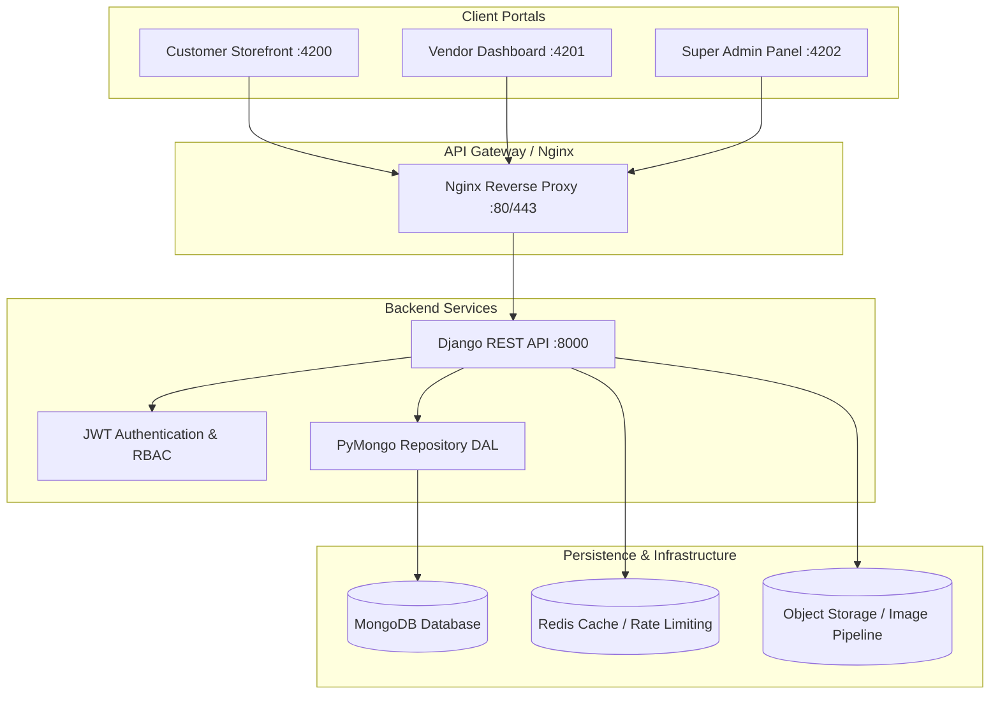

# NearbyBazaar: Ghar Tak — Apki Apni Dukaan
## System Architecture & Technical Specification

### 1. Architectural Overview
NearbyBazaar is a hyper-local, multi-vendor commerce platform architected to connect neighborhood Indian shopkeepers (kirana, fresh vegetables/fruits, electronics, apparel) with local residents for rapid doorstep delivery ("Ghar Tak").

The platform is designed around three distinct operational domains:
1. **Customer Storefront (`customer`)**: High-conversion local neighborhood marketplace inspired by modern e-commerce and localized Indian shopping patterns.
2. **Vendor/Shopkeeper Dashboard (`vendor`)**: Streamlined operational hub for inventory, order processing (Pending -> Confirmed -> Processing -> Shipped -> Delivered), and performance tracking.
3. **Super Admin Control Center (`admin`)**: Platform governance, shop application vetting, catalog moderation, audit logging, and aggregate analytics.



### 2. Monorepo Organization
```
NearbyBazaar/
├── backend/                  # Django REST API & PyMongo Data Access Layer
│   ├── config/              # Core Django settings, URLs, WSGI/ASGI
│   ├── apps/
│   │   ├── accounts/        # User models, JWT Auth, RBAC
│   │   ├── shops/           # Shop profiles, vendor applications
│   │   ├── catalog/         # Products, categories, search indexing
│   │   ├── cart/            # Multi-vendor cart & server pricing
│   │   ├── orders/          # Parent orders & seller fulfillment groups
│   │   ├── payments/        # Payment abstraction & idempotency
│   │   ├── delivery/        # Local addresses & delivery calculation
│   │   ├── reviews/         # Product & shop ratings
│   │   ├── promotions/      # Discounts & vouchers
│   │   ├── notifications/   # Real-time and in-app alerts
│   │   ├── support/         # Customer support tickets
│   │   ├── analytics/       # Aggregations & reporting
│   │   ├── audit/           # Append-only security audit trail
│   │   └── common/          # PyMongo DAL, serializers, rate limiter
│   ├── tests/               # Comprehensive automated test suite
│   ├── manage.py
│   ├── requirements.txt
│   └── .env.example
├── frontend/                 # Angular applications
│   ├── customer/            # Customer shopping storefront (port 4200)
│   ├── vendor/              # Vendor/Shopkeeper dashboard (port 4201)
│   ├── admin/               # Super Admin control center (port 4202)
│   └── shared/              # Reusable design tokens & models
├── infrastructure/           # Docker, Nginx, deployment scripts
└── docs/                     # Specifications and technical guides
```

### 3. Role-Based Access Control (RBAC)
| Role | Boundary | Permissions |
|---|---|---|
| `CUSTOMER` | Public & Customer APIs | Browse, search, add to cart, checkout, view own orders, write reviews, manage own addresses. |
| `VENDOR_ADMIN` | Scoped to Shop ID | Manage products, pricing, stock, view incoming orders for own shop, update fulfillment status, view shop analytics. Zero cross-shop visibility. |
| `SUPER_ADMIN` | Global Platform | Review shop applications, approve/reject vendors, activate/suspend users and shops, global orders, platform promotions, audit logs. |
